# Window Design Studio V1.2 开发前检查报告

## 检查边界

- 检查依据：`V1.2_门窗组件参数与绘图修改任务书.md`，文件位于用户提供的 Downloads 路径；基线为 GitHub 分支 `codex/window-design-studio-v1.1`。
- 基线提交：`b42fa6c2eda2c3dd54896d1f44b22cdf671e1995`（V1.1 PR #1 分支头）。
- 本地会话启动时的工作目录是空仓库：分支 `master`，尚无提交，未配置远端；因此将 V1.1 分支克隆到独立子目录用于只读检查，没有覆盖该空仓库。
- 检查期间未修改 `index.html` 或产品绘图逻辑。生成了 14 张基线截图；截图不包含选中框和 toast，保留工作台真实界面。
- 本报告区分：代码/参数可直接确认项；需要截图/不同尺寸浏览器验证的项；需要产品/工程人员确认的制图语义。

## 1. 分支与工作区

| 项目 | 结果 |
|---|---|
| 会话根目录 | `C:\Users\54497\Documents\ChatGPT\window-design` |
| 根目录 Git | `master`，`No commits yet`，没有项目文件和远端 |
| V1.1 基线副本 | 子目录 `window-design-studio-v1.1`，分支 `codex/window-design-studio-v1.1` |
| V1.1 起始状态 | 克隆后工作区干净，HEAD=`b42fa6c2eda2c3dd54896d1f44b22cdf671e1995` |
| V1.1 源码变更 | 无；仅增加基线截图和本报告（尚未提交） |

后续若获确认实施 V1.2，应从 V1.1 基线新建 `codex/window-design-studio-v1.2`，不在 `main` 或 V1.1 分支直接开发。

## 2. 组件 ID、名称、kind 和默认尺寸核对

任务书第 2 节的 14 个条目与基线 `defs` 完全一致：ID、中文名称、kind、默认宽高及宽高最小/最大值均无差异；未发现需要迁移或保留的 ID 冲突。

| ID | 组件 / kind | 默认 W×H (mm) | minW–maxW | minH–maxH | 核对 |
|---|---|---:|---:|---:|---|
| W001 | 固定窗 / `fixed` | 1500×1800 | 300–4000 | 300–3000 | 一致 |
| W002 | 左内开窗 / `casement` | 700×1200 | 400–900 | 600–2400 | 一致；默认 `opening=left` |
| W003 | 上悬窗 / `awning` | 1200×1000 | 400–4000 | 400–3000 | 一致 |
| W004 | 下悬窗 / `hopper` | 1200×1000 | 400–4000 | 400–3000 | 一致 |
| W005 | 单提拉窗 / `singleHung` | 1200×1500 | 500–4000 | 600–3000 | 一致 |
| W006 | 双扇平开窗 / `double` | 1500×1500 | 1000–3000 | 600–2600 | 一致 |
| W007 | 双提拉窗 / `doubleHung` | 1500×1500 | 600–4000 | 600–3000 | 一致 |
| W008 | 百叶窗 / `louver` | 1200×1200 | 400–4000 | 400–3000 | 一致 |
| W010 | 两轨推拉窗 / `sliding` | 1500×1500 | 700–4000 | 600–2800 | 一致 |
| D001 | 单开门 / `door` | 900×2100 | 600–1400 | 1800–2600 | 一致 |
| D003 | 双开平开门 / `doubleDoor` | 1500×2100 | 1000–3000 | 1800–3000 | 一致 |
| D004 | 单扇推拉门 / `singleSlidingDoor` | 900×2100 | 700–3000 | 1800–3000 | 一致 |
| D005 | 双扇推拉门 / `doubleSlidingDoor` | 1800×2100 | 1200–5000 | 1800–3000 | 一致 |
| D006 | 两轨推拉门 / `slidingDoor` | 1800×2200 | 1200–5000 | 1800–3000 | 一致 |

## 3. 现有绘图与导出实现

- 几何入口：`componentSVG(o)`；门窗均使用局部 `(0,0)` 到 `(w,h)` 坐标。通用 `ratioRect/ratioLine/ratioArrow` 按 1000×1000 归一化坐标换算。
- 部分 kind 使用归一化绘制，另一些使用 `m=min(70, 0.08W, 0.08H)` 加固定偏移。多处符号仍含固定值（例如平开五金偏移 35、推拉箭头位置 130/50）；并非所有几何都按任务书建议比例参数化。
- 组件填充、外框、内框、玻璃边界、开启/移动符号、拼角线都从 `componentSVG` 生成；画布和 SVG/PNG 导出复用 `objectSVG`。PDF 走浏览器打印，并由画布 SVG 绘制当前场景。
- 基线默认 `frameFill=true`、填充色 `#005BAC`、透明度 1；拼角 `joint='45_degree'` 且 `joint` 图层显示；图层颜色黑色、线宽 1。均与任务书要求保留项一致。
- 组件 `glass` 字段默认为 `double`，但基线绘图未根据 `single/double/tempered` 改变玻璃几何；手册/属性面板说明它目前是配置记录。

## 4. 按任务书发现的明确差异

以下均为代码确认，不是对工程标准的判断：

| 优先级 | 组件/范围 | 基线实际行为 | 与任务书差异 |
|---|---|---|---|
| P1 | 通用比例参数 | 比例、上限值和固定偏移散落在 `componentSVG` 与 ratio helper 中；没有集中 `frameRatio/sashRatio/glassInsetRatio` 配置 | 需要集中参数并确认哪些既有比例有更好视觉效果，不宜一刀切替换 |
| P1 | W008 | 固定绘制 6 条横线，坐标为 140、284、428、572、716、860（归一化）；数量没有属性；共享玻璃图层矩形仍默认绘制 | 缺少 3–20 叶片数量编辑和 `showGlassBoundary` 独立开关；应保持仅横向、默认 6 片 |
| P1 | W010 / D006 | 左右扇各为一块矩形，中间是一根框图层竖线；两个短水平箭头靠近中线；没有独立的两个相邻扇边界/可见交叠参数 | 任务书要求扇边界和交叠层次足以区别中梃分格窗；视觉 overlap 建议分别为 2.5%，不能当作真实搭接尺寸 |
| P1 | D004 | 单扇的归一化矩形加一个方向箭头；由 `opening` 控制左右，箭头位置按比例缩放 | 结构基本接近要求；仍需验证极端宽高比时箭头与边框不冲突 |
| P1 | D005 | 左右矩形分别使用 50–525 和 475–950 归一化范围，约 5% 视觉交叠；双箭头相背 | 交叠符合建议初值；箭头层与中缝的窄尺寸可读性需截图验证；两个方向目前由绘图常量表达，没有明确的数据字段 |
| P1 | D001 / D003 | 门复用平开窗/双扇开启符号；共享玻璃边界绘制逻辑会显示玻璃框线，`glass` 配置不改变图形 | 任务书要求按门扇玻璃配置决定，不应给纯门板无提示地显示玻璃边界；需确认当前组件默认代表玻璃门还是门板 |
| P2 | W002 | 默认 `opening=left`；选项为“左开/右开”，没有“从室内看/从室外看”说明 | 默认与名称一致；观察方向尚未在 UI 明示。应先确认产品用语，不改 ID/name |
| P2 | W003/W004/W005/W007 | 当前分别由固定 kind 分支画上悬/下悬/提拉符号；多数几何可随尺寸缩放，但符号位置和长度含固定归一化比例 | 需做极端宽高比截图验证；当前属性面板不提供无效的左右/上悬切换 |
| P2 | 拼角线 | 所有门窗组件在 `joint='45_degree'` 且图层显示时，连接外角与玻璃边界 | 默认状态符合“保留 V1.1”；任务书要求不得穿过百叶/开启符号，需逐图截图核对冲突 |

## 5. 需要视觉/交互实测的事项

- 已在桌面 Chrome 1440×1000、默认画布缩放下逐一创建 14 个组件并截图。截图证明各 ID 可创建且 SVG 有几何；这不是所有宽高比例、打印输出或工程适用性的确认。
- 需要后续测试 W010/D006 在 W/H=0.5、1.0、2.5 时的扇线/箭头可辨性；W008 在 3、6、8、12、20 叶片及不同高宽比的均匀间距、边界和重叠；最小/最大尺寸下所有内部元素是否越界。
- 需要画布、SVG、白底/透明 PNG、PDF 对同一几何作可视一致性比对，并检查窄屏布局。
- 需检查每个组件的拼角线是否与叶片、扇边界、开启符号交叉，以及图层关闭后是否完全消失。

## 6. 需确认但不阻塞基线报告的产品问题

1. D001/D003 的默认 `glass='double'` 是玻璃门，还是实心门？如果同一组件需要两者，期望通过现有 `glass` 选项切换玻璃边界还是实心门板？任务书要求配置真正影响图形，但没有列出可用门板构造数据。
2. W002 “左内开/右开”希望按“从室内看”还是“从室外看”定义？任务书要求 UI 明确观察方向，但没有指定哪一个。
3. W010/D006 与 D005 的箭头关系应继续沿用当前相背移动，还是有其他实际开合组合？任务书建议相背方向，但未指定“开启/关闭”状态语义。实现前应以当前建议做示意值并在 UI 中标明方向，若要改变则需确认。

任务书已明确 V1.2 属于正面立面示意，默认填充/拼角/ID 必须保留；无需另行确认这些产品决策。所有比例值是软件视觉建议，不表示真实型材、搭接、玻璃厚度或施工尺寸。

## 7. 修改前截图索引

截图为基线 V1.1 原样渲染，尺寸 1440×1000，默认组件尺寸、默认颜色和拼角设置，已隐藏选中框与 toast。可逐张打开：

- 窗：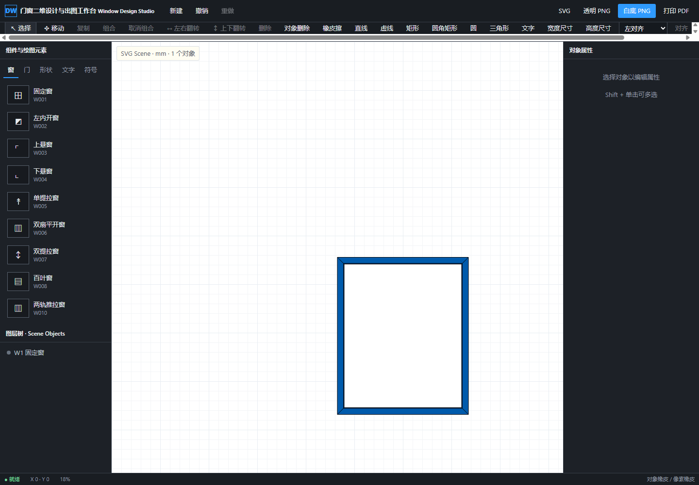 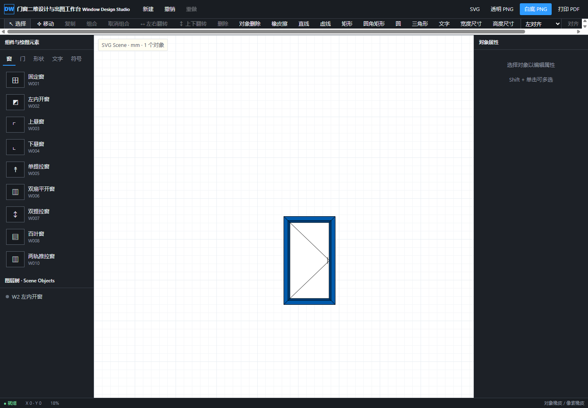 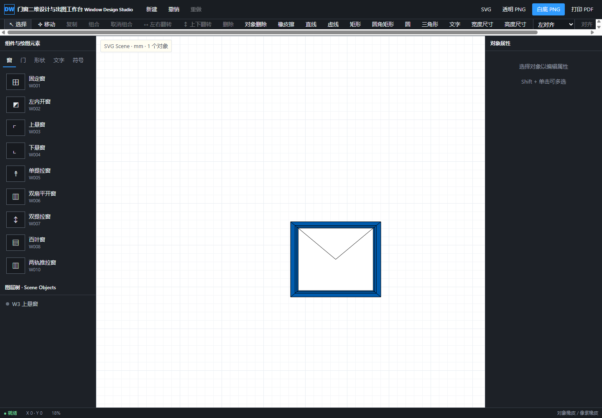 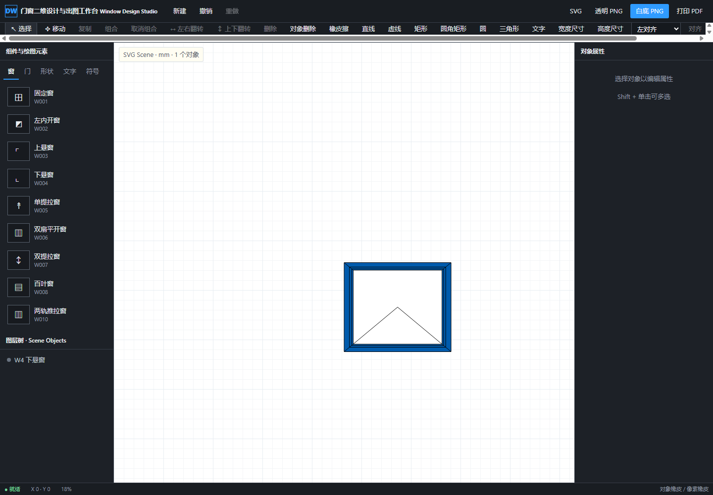 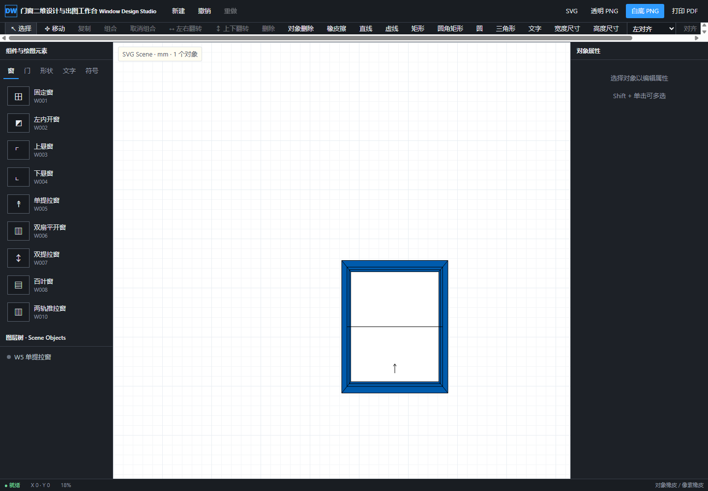 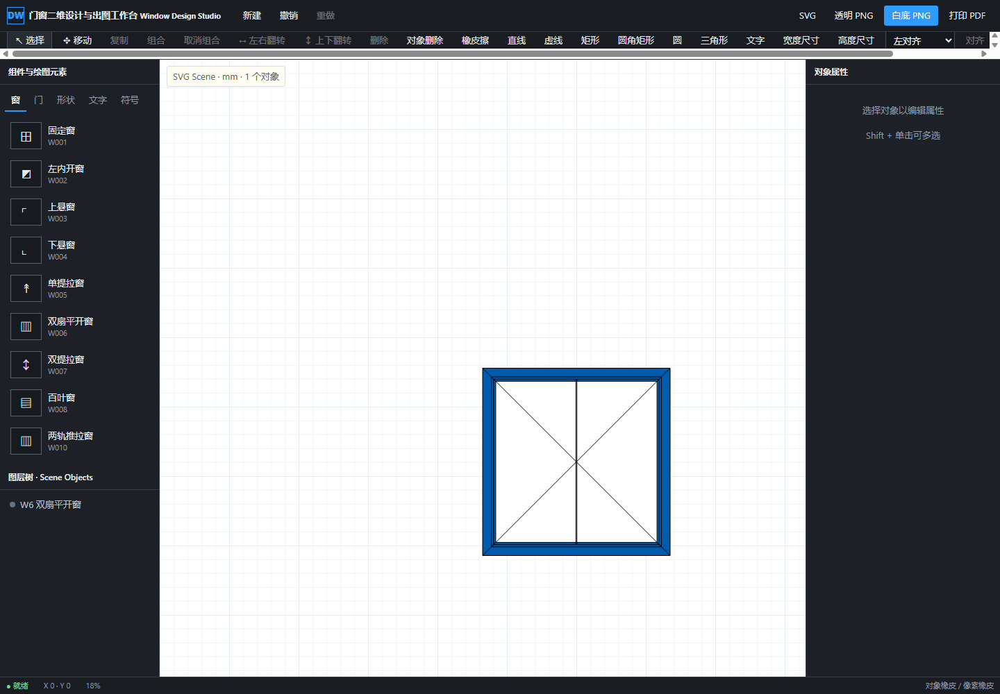 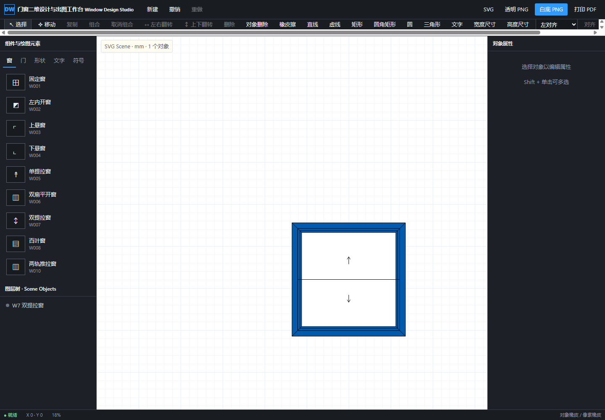 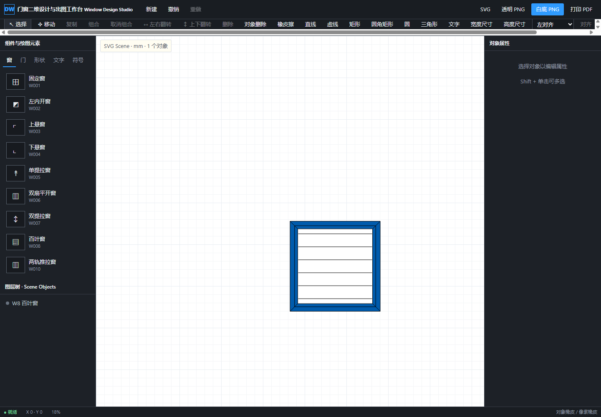 
- 门：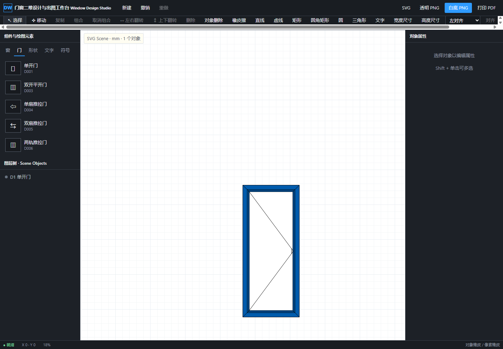 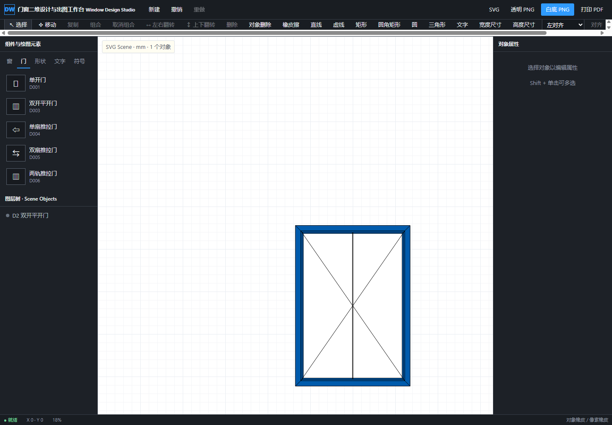 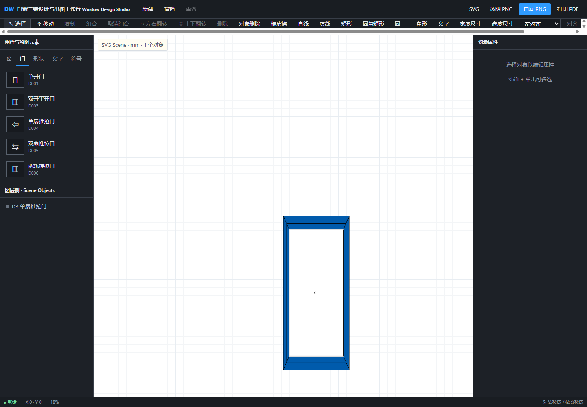 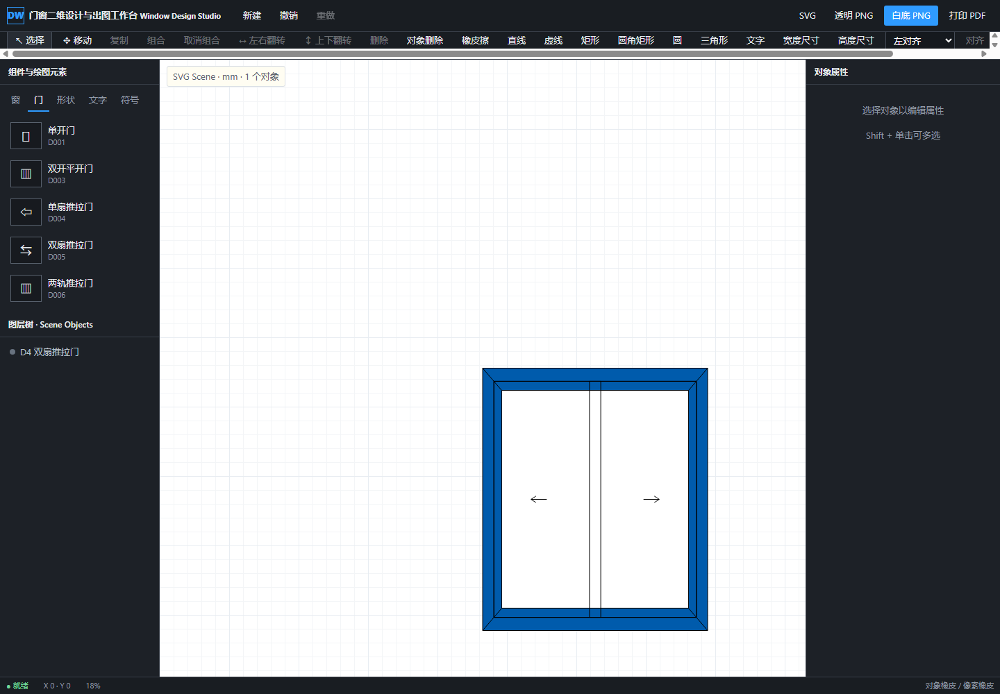 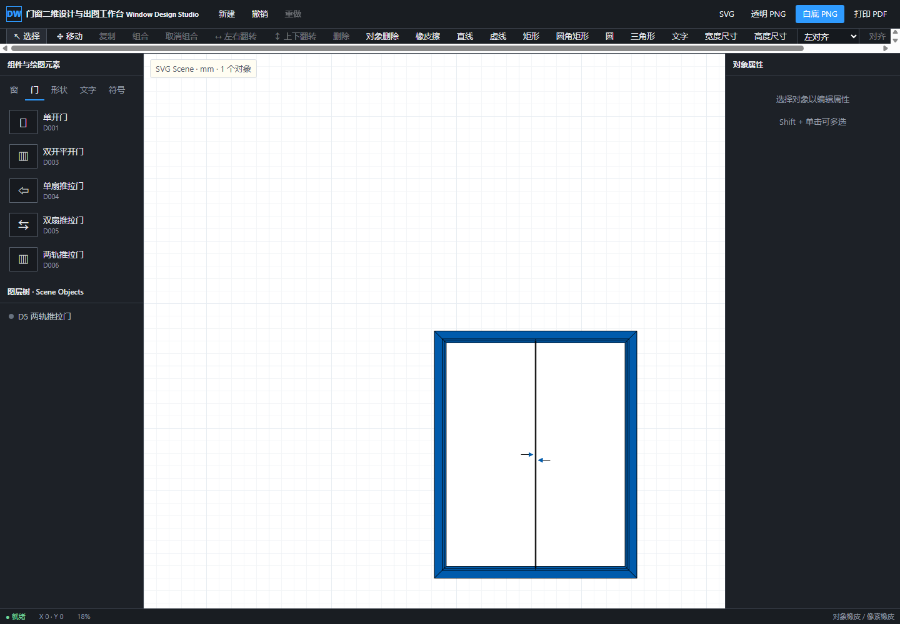

截图源于真实 V1.1 页面和独立 Chrome，不是示意/合成图。

## 8. 进入正式开发前

本报告阶段没有改产品代码。按用户要求，当前停在“基线检查完成、等待确认”，未开始 V1.2 绘图实现，也未创建 V1.2 PR。确认开始后，才从 V1.1 基线创建独立 V1.2 分支，并按用户定义的阶段逐项汇报。
